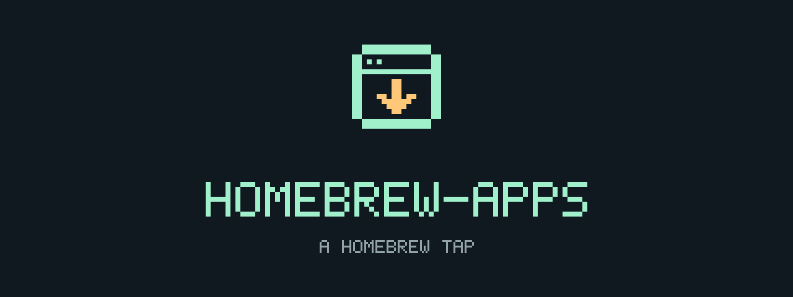

<div align="center">



**Small tap. More possibilities.**

A growing collection of apps and tools by [@jonaskahn](https://github.com/jonaskahn), delivered through Homebrew.

`[ HOMEBREW TAP ]` · `[ MAC + LINUX* ]` · `[ INSERT COMMAND ]`

<sub>*Platform support depends on the individual package.</sub>

</div>

---

## 01 / PRESS START

Add the tap once:

```console
brew tap jonaskahn/apps
```

Then install a package using `brew install jonaskahn/apps/<name>`.

> **BUILD IN PROGRESS** — Relo is the first staged formula. Its release checksums are still placeholders, so installation is not ready yet. The commands below are for use once the formula is finalized.

## 02 / SELECT YOUR APP

| App | What it does | Platform | Status |
| :-- | :-- | :-- | :-- |
| [Relo](https://github.com/jonaskahn/relo) | Local proxy letting coding agents talk to any model | macOS / Linux | Staged |

### Relo / install & run

```console
brew install jonaskahn/apps/relo
relo daemon start
```

Open the console at **<http://127.0.0.1:10101>**.

### Relo / next level

```console
brew upgrade jonaskahn/apps/relo
```

During an upgrade, the formula stops the running daemon and frees its ports before placing the new version.

### Relo / save & quit

Stop the daemon before uninstalling so its ports are freed. Your data stays in `~/.relo`:

```console
relo daemon stop --force
brew uninstall relo
```

For Relo-managed cleanup that keeps your data:

```console
relo uninstall --keep-data
brew uninstall relo
```

To remove your data too, run `relo uninstall --wipe` before `brew uninstall relo`.

> **ONE PLAYER ONLY** — Only one Relo installation may be active at a time. If you installed it through the app, npm, or another method, keep using that method or remove it completely before installing through Homebrew.
>
> **AUTOSTART** — Do not use `brew services`. Use `relo autostart enable` or `relo autostart disable` instead.

## 03 / EXPAND THE LIBRARY

Command-line packages live in [`Formula/`](Formula/). Future desktop-app casks will live in `Casks/`.

Found a problem or have a suggestion? [Open an issue](https://github.com/jonaskahn/homebrew-apps/issues).

---

<div align="center">

`> READY WHEN YOU ARE_`

</div>
